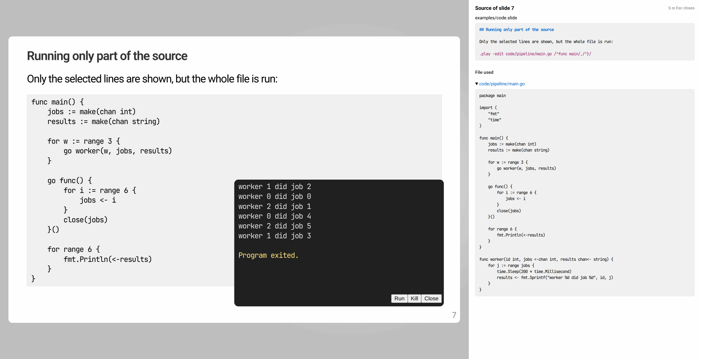
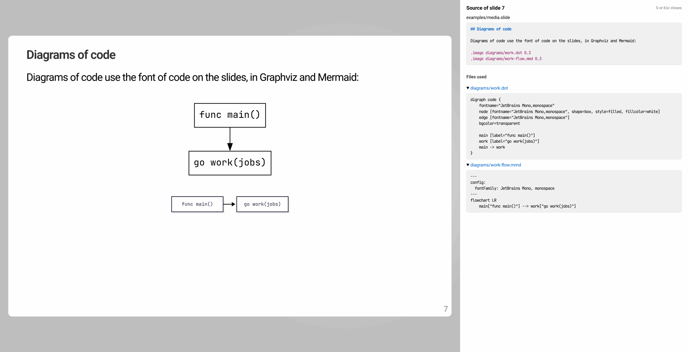

<!-- Code generated by internal/readmegen from internal/readmegen/header.md, doc.go and pkg/present/doc.go. DO NOT EDIT. -->

# present

Present is a simple presentation tool for slides written as plain text files
with Markdown, and shown in the browser.

## Features

- Slides and articles written in plain-text Markdown, shown in the browser.
- Code from source files that runs live from the slide: Go, Python, JavaScript,
  TypeScript, or anything with a shebang.
- Images, video, and Graphviz and Mermaid diagrams.
- Presenter notes window, kept in sync with the slides.
- Hot reload while you write.
- Single binary that works offline.

## This is a fork

Present is based on [golang.org/x/tools/cmd/present](https://pkg.go.dev/golang.org/x/tools/cmd/present).
It started as a verbatim copy of it at commit
[a3af45f248c005a2f2485ca99ad978547753a17c](https://go.googlesource.com/tools/+/a3af45f248c005a2f2485ca99ad978547753a17c)
("internal/refactor/inline: reduce void calls in tail position").

Most markdown based slides made for the x/tools present should work but the old
non markdown syntax support has been removed, the fonts have changed and the
padding outside of the slide body is slightly reduced. Presentations in the old
syntax can be converted to Markdown with `present convert-legacy`.

## Start demo

The quickest way to learn present is to look at the [examples](examples):
presentations that show every feature, from Markdown text and speaker notes
to runnable code, diagrams and video. They are built into present, so one
line downloads and runs the latest version and shows them along with this
documentation:

    go run github.com/some-programs/present@latest serve -doc -notes

Then open http://127.0.0.1:3999. The index lists the presentations in the
current directory, below links to the documentation and the examples. On a
slide, press S to see its source beside it.
## Command

Present displays slide presentations and articles. Its serve command runs a web server that presents slide and article files from the current directory:

	present serve [flags]

Present without a command lists the commands. The flags described below are flags of serve, as in "present serve -notes"; "present serve -h" lists them all.

Present assumes presentation authors are trusted, and should not be used with untrusted inputs.

Programs in .play blocks are built and run on the machine running present, and their output is streamed to the browser over a WebSocket. Run with -play=false to disable this.

With -hot, an open presentation reloads in the browser whenever its file, or a file it uses, changes. It opens at the first slide that changed, and a presentation that no longer parses shows its error over the old slides, as does a diagram that cannot be rendered. -hot cannot be used with -notes.

An .image of a diagram file, Graphviz (.dot) or Mermaid (.mmd, .mermaid), shows the SVG file of the same name, which present renders with dot or mmdc whenever the diagram file changes. With -norender, present does not render them, and shows the existing SVG files as they are; -dot= or -mmdc= does the same for one kind of diagram.

With -doc, the Talks page lists this documentation, served at /\_doc, and the example presentations, which are built into present and served at /\_examples, for reading them next to the presentations being written. Pressing S on a slide then shows its source beside it: the lines of the presentation file that make it, and the files that its commands use. Adding ?source=true to the URL of a presentation opens it with the source shown, and ?source=false with it hidden. The fonts of the slides are served too, at /download/fonts.tar, for installing them.

Other commands write new files from skeletons with present's defaults, and fail rather than overwrite a file:

	present new-slide my-talk                    # my-talk.slide, a slide presentation
	present new-article notes                    # notes.article, an article
	present new-dot diagrams/flow                # diagrams/flow.dot, a Graphviz diagram
	present new-mmd diagrams/flow                # diagrams/flow.mmd, a Mermaid flowchart
	present new-mmd -type sequence diagrams/seq  # diagrams/seq.mmd, a Mermaid sequence diagram

The diagrams use the fonts of the slides, as described under Diagram Style in the present package: Roboto, or JetBrains Mono with -mono, for a diagram of code. The -type of a Mermaid diagram is flowchart, the default, sequence, class or state. Run "present COMMAND -h" for the usage of a command.

The export command writes slide presentations and articles as static HTML pages, for any web server to serve:

	present export my-talk.slide                 # present.export/my-talk.html
	present export -o public talks/*.slide       # public/talks/*.html

Each page is written to the -o directory, present.export by default, at the path of its file under the current directory, with the images, videos and iframe pages it shows, and the style sheets, scripts and fonts of the pages in the static directory. Links to other presentations point at their pages. Diagrams are rendered first, and export fails if one cannot be. The pages cannot run code, and have no presenter notes. They work opened from files as well as served by any web server, since the style sheet embeds the fonts, which browsers do not load from files.

With -source, pressing S on an exported slide shows its source, notes included, as with -doc, and the files that its commands use are written too.

The convert-legacy command converts presentations in the legacy present markup, which golang.org/x/tools/present also reads, to Markdown. It prints the result, or with -w, converts each file in place:

	present convert-legacy my-talk.slide         # print my-talk.slide in Markdown
	present convert-legacy -w *.slide *.article  # convert them all in place

Input files are named foo.extension, where "extension" defines the format of the generated output. The supported formats are:

	.slide        // HTML5 slide presentation
	.article      // article format, such as a blog post

## File format

Package present implements parsing and rendering of present files, which can be slide presentations as in golang.org/x/tools/cmd/present or articles as in golang.org/x/blog (the Go blog).

This package assumes presentation authors are trusted, and should not be used with untrusted inputs.

### File Format

Present files begin with a header giving the title of the document and other metadata, which looks like:

	# Title of document
	Subtitle of document
	15:04 2 Jan 2006
	Tags: foo, bar, baz
	Summary: This is a great document you want to read.

The title line must begin with "# ". The body of the file uses Markdown for text markup. Files in the legacy present markup, whose title line has no "# " prefix, are not supported, but the convert-legacy command of present converts them to Markdown.

The date line may be written without a time:

	2 Jan 2006

In this case, the time will be interpreted as 11am UTC on that date.

The tags line is a comma-separated list of tags that may be used to categorize the document.

The summary line gives a short summary used in blog feeds.

Only the title is required; the subtitle, date, tags, and summary lines are optional. The summary defaults to being empty.

After the header come zero or more author blocks, like this:

	Author Name
	Job title, Company
	joe@example.com
	https://url/
	@twitter_name

The first line of the author block is conventionally the author name. Otherwise, the author section may contain a mixture of text, twitter names, and links. For slide presentations, only the plain text lines will be displayed on the first slide.

If multiple author blocks are listed, each new block must be preceded by its own blank line.

After the author blocks come the presentation slides or article sections, which can in turn have subsections. Each slide or section begins with a "##" header line, subsections begin with a "###" header line, and so on.

In addition to the marked-up text in a section (or subsection), a present file can contain present command invocations, each of which begins with a dot, as in:

	.code x.go /^func main/,/^}/
	.play y.go
	.image image.jpg
	.background image.jpg
	.iframe https://foo
	.link https://foo label
	.html file.html
	.caption _Gopher_ by [Renee French](https://instagram.com/reneefrench)

Other than the commands, the text in a section is interpreted as Markdown.

### Markdown Syntax

Markdown typically means the generic name for a family of similar markup languages. The specific variant used in present is CommonMark, with the tables of GitHub Flavored Markdown ([https://github.github.com/gfm/#tables-extension-](https://github.github.com/gfm/#tables-extension-)). See [https://commonmark.org/help/tutorial/](https://commonmark.org/help/tutorial/) for a quick tutorial.

Section headings can end in {#name} to set the HTML anchor ID for the heading to "name".

Lines beginning with "//" (outside of code blocks, of course) are treated as present comments and have no effect.

Lines beginning with ": ", and blocks from a "::: notes" line to a ":::" line, are treated as speaker notes, described below.

Example:

	# Title of Talk

	My Name
	9 Mar 2020
	me@example.com

	## Title of Slide or Section (must begin with ##)

	Some Text

	### Subsection {#anchor}

	- bullets
	- more bullets
	- a bullet continued
	  on the next line

	#### Sub-subsection

	Some More text

		Preformatted text (code block)
		is indented (by one tab, or four spaces)

	Further Text, including command invocations.

	## Section 2: Example formatting {#fmt}

	Formatting:

	_italic_
	// A comment that is completely ignored.
	: Speaker notes.
	**bold**
	`program`
	Markup—_especially italic text_—can easily be overused.
	_Why use scoped\_ptr_? Use plain **\*ptr** instead.

	Visit [the Go home page](https://golang.org/).

	| Column | Aligned right |
	|--------|--------------:|
	| cell   | cell          |

### Command Invocations

A number of special commands are available through invocations in the input text. Each such invocation contains a period as the first character on the line, followed immediately by the name of the function, followed by any arguments. A typical invocation might be

	.play demo.go /^func show/,/^}/

(except that the ".play" must be at the beginning of the line and not be indented as in this comment.)

Here follows a description of the functions:

code:

Injects program source into the output by extracting code from files and injecting them as HTML-escaped \<pre> blocks.  The argument is a file name followed by an optional address that specifies what section of the file to display. The address syntax is similar in its simplest form to that of ed, but comes from sam and is more general. See

	https://plan9.io/sys/doc/sam/sam.html Table II

for full details. The displayed block is always rounded out to a full line at both ends.

If no pattern is present, the entire file is displayed.

Any line in the program that ends with the four characters

	OMIT

is deleted from the source before inclusion, making it easy to write things like

	.code test.go /START OMIT/,/END OMIT/

to find snippets like this

	tedious_code = boring_function()
	// START OMIT
	interesting_code = fascinating_function()
	// END OMIT

and see only this:

	interesting_code = fascinating_function()

Also, inside the displayed text a line that ends

	// HL

will be highlighted in the display. A highlighting mark may have a suffix word, such as

	// HLxxx

Such highlights are enabled only if the code invocation ends with "HL" followed by the word:

	.code test.go /^type Foo/,/^}/ HLxxx

The .code function may take one or more flags immediately preceding the filename. This command shows test.go in an editable text area:

	.code -edit test.go

This command shows test.go with line numbers:

	.code -numbers test.go

play:

The function "play" is the same as "code" but puts a button on the displayed source so the program can be run from the browser. Although only the selected text is shown, all the source is included in the HTML output so it can be presented to the compiler. A file whose name ends in .py is run with python3, and one ending in .js with node. One ending in .ts is type checked and compiled with tsc and then run with node; without tsc, node runs it by stripping its types. A program that starts with "#!" is run with that interpreter; anything else is built and run as Go.

link:

Create a hyperlink. The syntax is 1 or 2 space-separated arguments. The first argument is always the HTTP URL.  If there is a second argument, it is the text label to display for this link, rendered as inline Markdown.

	.link https://golang.org golang.org

image:

The template uses the function "image" to inject picture files.

The first argument is always the file name. On slides, the image is fitted into the space left for it, below any text and above any caption, keeping its aspect ratio; with no other arguments it fills that space. A single further argument is a fraction from 0.0 to 1.0 of the slide's content area that the image may use. Two further arguments are the height and width, each a fraction, a number of pixels, or an underscore for no limit. The image never grows beyond the space left for it.

	.image images/betsy.jpg
	.image images/betsy.jpg 0.5
	.image images/janet.jpg _ 300
	.image images/janet.jpg 0.4 _

A diagram file is shown as the SVG file of the same name next to it: a Graphviz file (.dot), rendered with dot, or a Mermaid file (.mmd or .mermaid), rendered with the Mermaid CLI, mmdc. The present program renders it whenever the diagram file has changed, and marks the SVG with a hash of the diagram file to tell. If the tool is missing or fails, an earlier SVG is shown, and the error appears in the presenter notes window, or at the top of the page with -hot; without an earlier SVG, the error takes the image's place. Diagram files that share an SVG file, such as flow.dot and flow.mmd, are not rendered, and are an error of that kind. See Diagram Style for making diagrams match the slides.

	.image diagrams/flow.dot
	.image diagrams/sequence.mmd
	.image -background-color transparent diagrams/sequence.mmd

The -background-color flag, before the file name, sets the background of a Mermaid diagram to a CSS color written without spaces, such as transparent, #f8f8f8 or rgb(0,0,0,0.1); it is white otherwise. A Graphviz file sets its own background with the bgcolor attribute.

video:

The template uses the function "video" to inject video files.

The syntax is simple: 2 or 4 space-separated arguments. The first argument is always the file name. The second argument is always the file content-type. If there are more arguments, they are the height and width; both must be present, or substituted with an underscore. Replacing a dimension argument with the underscore parameter preserves the aspect ratio of the video when scaling.

	.video videos/evangeline.mp4 video/mp4 400 600

	.video videos/mabel.ogg video/ogg 500 _

background:

The template uses the function "background" to set the background image for a slide.  The only argument is the file name of the image.

	.background images/susan.jpg

caption:

The template uses the function "caption" to inject figure captions.

The text after ".caption" is rendered as inline Markdown and embedded in a figcaption element.

	.caption _Gopher_ by [Renee French](https://instagram.com/reneefrench)

fontsize:

The function "fontsize" sets the font size of what follows it in the section, up to the next fontsize or the end of the section. Code and subsection headings are sized along with the text. The size is a factor of the default size, a percentage of it, or a size in px or pt; without a size, fontsize goes back to the default.

	.fontsize 0.8
	.fontsize 120%
	.fontsize 20px
	.fontsize

iframe:

The function "iframe" injects iframes (pages inside pages). Its syntax is the same as that of image.

html:

The function html includes the contents of the specified file as unescaped HTML. This is useful for including custom HTML elements that cannot be created using only the slide format. It is your responsibility to make sure the included HTML is valid and safe.

	.html file.html

### Diagram Style

Diagrams look like part of the presentation when they use its fonts: Roboto for text and JetBrains Mono for code. The new-dot and new-mmd commands of the present program write Graphviz and Mermaid files that do, in Roboto, or in JetBrains Mono with -mono.

A Graphviz diagram:

	digraph example {
		fontname="Roboto,sans-serif"
		node [fontname="Roboto,sans-serif", style=filled, fillcolor=white]
		edge [fontname="Roboto,sans-serif"]
		bgcolor=transparent

		main -> worker
	}

A Graphviz diagram of code:

	digraph code {
		fontname="JetBrains Mono,monospace"
		node [fontname="JetBrains Mono,monospace", shape=box, style=filled, fillcolor=white]
		edge [fontname="JetBrains Mono,monospace"]
		bgcolor=transparent

		main [label="func main()"]
		work [label="go work(jobs)"]
		main -> work
	}

A Graphviz diagram can use both fonts, with fontname on a node or edge, or with FONT in an HTML-like label for part of a label:

	digraph mixed {
		fontname="Roboto,sans-serif"
		node [fontname="Roboto,sans-serif", style=filled, fillcolor=white]
		edge [fontname="Roboto,sans-serif"]
		bgcolor=transparent

		request [label="HTTP request"]
		handler [label="func handle()", fontname="JetBrains Mono,monospace"]
		reply [label=<writes w>]
		request -> handler -> reply
	}

A Mermaid diagram:

	---
	config:
	  fontFamily: Roboto, sans-serif
	---
	sequenceDiagram
	    Browser->>present: Run

A Mermaid diagram of code:

	---
	config:
	  fontFamily: JetBrains Mono, monospace
	---
	flowchart LR
	    main["func main()"] --> work["go work(jobs)"]

A Mermaid flowchart can use both fonts, with a class for each, as the flowcharts of new-mmd define: text for Roboto and code for JetBrains Mono, whichever font the diagram has. The comma in a font is escaped as \\,, since a comma separates the styles of a class:

	---
	config:
	  fontFamily: Roboto, sans-serif
	---
	flowchart LR
	    classDef text font-family:Roboto\,sans-serif
	    classDef code font-family:JetBrains Mono\,monospace
	    request["HTTP request"] --> handler["func handle()"]:::code

Other types of Mermaid diagrams use one font: a state diagram cannot escape the comma of a class, so a font in it has no fallback, and the classes of a class diagram and the participants of a sequence diagram cannot set one.

The SVG is shown as an image, which cannot use the fonts of the page, so present embeds the Roboto and JetBrains Mono faces that an SVG file names in it as it serves it; the file itself is unchanged. This holds for every SVG file that present serves, also images and backgrounds that are not diagrams. Both tools size labels with the fonts installed where present runs, though, so install Roboto and JetBrains Mono there for the labels to fit. Present serve -doc serves both as TrueType files, with their licenses, at /download/fonts.tar.

### Presenter Notes

Lines that begin with ": " are treated as presenter notes. By default, presenter notes are collected but ignored.

When running present serve with -notes, typing 'N' in your browser displaying your slides will create a second window displaying the notes. The second window is completely synced with the main window, except that presenter notes are only visible in the second window.

Notes are Markdown, so they can have \*\*bold\*\* text, \`code\` and links. Each line of notes is a paragraph of its own. Longer notes, with several paragraphs, lists or code, go in a block that starts with a "::: notes" line and ends with a ":::" line, as in Pandoc and reveal.js. Everything in between is Markdown, also lines that would otherwise be headings, commands or comments.

Notes may appear anywhere within the slide text, also in its subsections and before the first slide, where they belong to the title slide. For example:

	## Title of slide

	Some text.

	: Presenter notes (first paragraph)

	Some more text.

	: Presenter notes (subsequent paragraph(s))

	::: notes
	A block of notes:

	- with a list
	- and more

	    go test ./...
	:::
